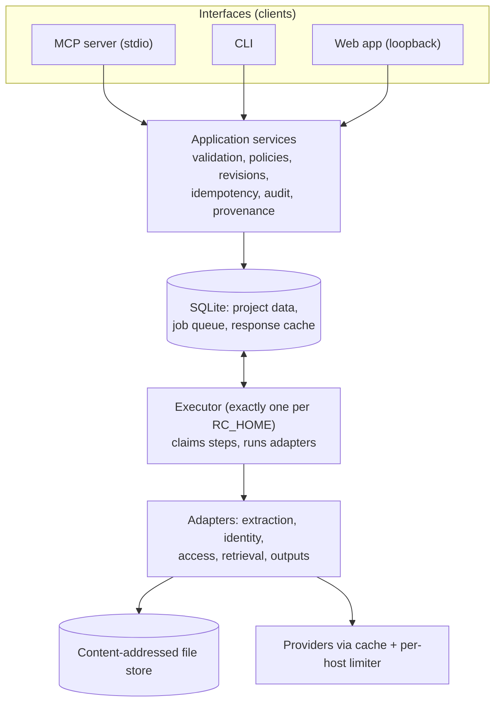
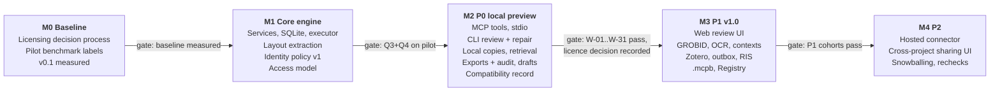

# RefCollector: Implementation Specification v3

**Date:** 20 October 2026 · **Owner:** Faris · **Status:** implemented in 0.2.0b1. Later sections may describe superseded proposals; the [decision log](../orchestration/decisions.md) and the code win where they differ.
**Repository baseline:** `13771b410a5e720c15a52b15d61828dbb42cc11d`
**Supersedes:** merged spec v2 (same date). Changes are mapped in Appendix A.

**Release terms used throughout**

| Term | Meaning |
|---|---|
| P0 | Local preview: first release, local only, includes the MCP server |
| P1 | v1.0 |
| P2 | Later |

**Statement labels:** *Observed* = read in the baseline code or a cited document. *Proposed target* = a goal to test. *Measured* = a result from an executed benchmark; **this document contains no measured results.**

---

## 1. Purpose and principles

RefCollector turns a document's bibliography into a checked, traceable reference library for people and AI agents, with legal copies where configured sources find them and visible gaps where they don't.

1. Prefer an unresolved citation over a wrong accepted match.
2. Keep the original citation text; corrections are revisions, not overwrites.
3. Explain uncertainty with reason codes, not uncalibrated percentages.
4. Record where every decision came from (automation, agent, or an interactive approval surface) and never let a tool argument or a connection identity stand in for a recorded user approval (section 7.4).
5. Keep identity, access discovery, access classification, local copies and retrieval as separate questions (sections 7.3, 10).
6. The P0 workflow needs no LLM, no account, no Docker and no Zotero.
7. Default retrieval uses open-access or explicitly approved locations. A trusted local operator can configure the optional DOI HTML fallback (10.4, D-36). No sending of messages.
8. Never invent identifiers, metadata, contacts or licences.
9. One engine: every interface calls the same application services and the same executor (section 6).

---

## 2. Baseline observations

*Observed* in the baseline commit. Each row points to the section that defines the replacement behaviour.

| ID | Observation | Consequence | Addressed in |
|---|---|---|---|
| G1 | `Resolver.resolve()` returns a DOI-linked record without running `assess()`; the web app labels method `doi` as *high* | A valid DOI that names a different work is accepted without comparison | 9.2 |
| G2 | Text search returns the first candidate that passes `assess()` | Close competitors are never compared | 9.1 |
| G3 | When no PDF is saved for a resolved DOI, `pdf_status` becomes `paywalled`, whatever the cause | Network failures and missing OA locations are reported as paywalls | 10.1 |
| G4 | `pdf_text()` concatenates page text into one string | Page, column and position data are lost | 8.2 |
| G5 | `HEADING_RE` matches English headings only; one late heading is selected | "Daftar Pustaka" theses and per-chapter lists are missed | 8.2 |
| G6 | `split_references()` raises `SystemExit` when no heading is found; the web app's `run_job()` catches it and marks the job `error` | Works in the web app, but a process-level exception is the wrong contract for a shared library | 6.6, 11.5 |
| G7 | Jobs run in a daemon thread, one reference at a time, saved as JSON snapshots, with no response cache | No resumability, no concurrency control, repeated API calls | 6 |
| G8 | Workflow logic is split between `refcollector.py` and `webapp/app.py` | CLI and web app can diverge | 5 |
| G9 | Downloads are accepted on the `%PDF` signature alone | Supplements or other papers can be saved as the cited work | 10.4 |
| G10 | Drafts use "Dear Dr." and state that the sender lacks subscription access | Wrong honorifics; unverified claims | 11.2 |
| G11 | Inputs are PDF only; no retraction check | Agents holding identifiers cannot start; retracted works pass silently | 3 |
| G12 | The repository has no licence file. GitHub's terms let other users view and fork a public repository on GitHub, but reproduction, distribution and derivative works are not licensed | Third parties cannot lawfully reuse or redistribute the code outside those platform rights | 14.3 |

Retain: `assess()` field comparison and flags, `mailto` User-Agent, `Retry-After` handling, per-host blocking after a long rate-limit wait, the `%PDF` check (as one step of 10.4), manual DOI override, optional DOI HTML fallback disabled by default (D-36).

---

## 3. Release and capability matrix

Each row says when a capability first ships, what it needs, how it is advertised, and what happens when it is unavailable. "Advertised" means listed in `get_capabilities` and present in tool schemas. P1 values are **absent from P0 schemas**; a client sending one gets `FEATURE_NOT_AVAILABLE`.

| Area | Capability | First | Needs | Advertised as | When unavailable |
|---|---|---|---|---|---|
| Sources | Local PDF (text layer) | P0 | allow-listed folder | `source_types: ["pdf"]` | n/a |
| Sources | Pasted reference text | P0 | none | `source_types: ["text"]` | n/a |
| Sources | DOI, arXiv ID, identifier list | P1 | network | `source_types` | `FEATURE_NOT_AVAILABLE` |
| Sources | BibTeX, RIS, CSL JSON | P1 | none | `source_types` | `FEATURE_NOT_AVAILABLE` |
| Sources | Scanned PDF | P1 | OCR extra installed | `adapters.ocr: true` | import succeeds; extraction step fails `OCR_REQUIRED` |
| Sources | Upload handle | P2 | hosted edition | `source_types` | `FEATURE_NOT_AVAILABLE` |
| Stages | `extract`, `resolve`, `discover_access` | P0 | metadata network mode for the last two | `stages` | `NETWORK_MODE_DENIED` in offline mode |
| Stages | Retrieval (`download_files`) | P0 | retrieval network mode, `files:download` | tool listed | `NETWORK_MODE_DENIED` / `NOT_AUTHORIZED` |
| Stages | `contexts` (in-text citation mapping) | P1 | none (better with GROBID) | `stages` | `FEATURE_NOT_AVAILABLE` |
| Stages | Retraction and correction flags | P1 | network | `checks.integrity` | not run; no flag implied |
| Extraction | Built-in PyMuPDF layout adapter | P0 | none | `adapters.builtin` | n/a |
| Extraction | GROBID adapter | P1 | `RC_GROBID_URL` reachable | `adapters.grobid` | `auto` falls back to built-in with a warning; explicit `grobid` fails `ADAPTER_UNAVAILABLE` |
| Extraction | OCR adapter | P1 | `[ocr]` extra | `adapters.ocr` | see scanned PDF |
| Review ops | Edit text, split, merge, add, exclude, select/reject candidate, set DOI, set fields, locks | P0 | `references:write` | tools 14–15 | n/a |
| Review ops | Recorded user approval | P0 | CLI interactive review (TTY) | `approval_surfaces: ["cli_tty"]` | agents get `accepted_agent` only |
| Review ops | Recorded user approval in web review UI | P1 | web UI running | `approval_surfaces` | not offered |
| Access | Unpaywall, OpenAlex locations | P0 | contact email | `providers` | provider listed as failed; discovery `partial`/`failed` |
| Access | CORE, arXiv, Europe PMC | P1 | CORE key for CORE | `providers` | not consulted; recorded in `sources_consulted` |
| Local copies | Managed store reuse, user-attached files | P0 | none | `local_copies: ["managed", "attached"]` | n/a |
| Local copies | Zotero attachments | P1 | Zotero running, local API enabled | `local_copies` | skipped with warning; workflow continues |
| Integrations | Zotero push | P1 | local API write key (Zotero 10+) or Web API key | `export_targets` | `FEATURE_NOT_AVAILABLE` / `INTEGRATION_UNAVAILABLE` |
| Exports | BibTeX, CSL JSON, CSV, full JSON, unresolved list, audit report, manifest | P0 | none | `export_formats` | n/a |
| Exports | RIS, Obsidian notes | P1 | none | `export_formats` | `FEATURE_NOT_AVAILABLE` |
| Drafts | Request drafts as text and `.eml` artifacts | P0 | `drafts:create` | tool listed | n/a |
| Drafts | Outbox status tracking (`list_drafts`, `update_draft_status`) | P1 | none | tools listed | tools absent in P0 |
| Prompts | `reconstruct-bibliography`, `review-uncertain`, `recover-copies` | P0 | client prompt support | `prompts/list` | tools alone complete the workflow |
| Prompts | `triage-thesis`, `request-paywalled`, `audit-citations` | P1 | contexts, outbox, integrity | `prompts/list` | not listed |
| Interfaces | CLI incl. terminal review | P0 | none | n/a | n/a |
| Interfaces | Baseline web app (job view, exports) | P0 | none | n/a | n/a |
| Interfaces | Three-pane web review UI | P1 | none | n/a | CLI review used |
| Transport | MCP stdio | P0 | none | n/a | n/a |
| Transport | Local Streamable HTTP on loopback (single user, no OAuth, origin-checked) | P1 | `serve mcp --http` | n/a | not started |
| Transport | Hosted Streamable HTTP with OAuth and tenants | P2 | hosted edition | n/a | n/a |
| Packaging | PyPI package, `uvx` | P0 | none | n/a | n/a |
| Packaging | `.mcpb` bundle, Docker Compose, MCP Registry entry | P1 | none | n/a | n/a |
| Library | Cross-project work linking and library search | P1 | none | `library.shared_works` | project-scoped only |

---

## 4. P0 workflow (frozen)

This sequence must work end to end through **both** the CLI and MCP tools alone, with no GROBID, Zotero, citation contexts or hosted infrastructure.

| Step | CLI | MCP tools |
|---|---|---|
| 1 Import a source | `refcollector import thesis.pdf --project phd` | `create_project` / `get_project`, `import_source`, `get_source` |
| 2 Inspect extraction | `refcollector run --stages extract`, `refcollector list` | `start_job(extract)`, `get_job`, `list_references`, `get_reference` |
| 3 Resolve identities | `refcollector run --stages resolve` | `start_job(resolve)`, `get_job` |
| 4 Repair and review | `refcollector review` (interactive), `refcollector edit/split/merge/add/exclude` | `add_reference`, `update_reference` |
| 5 Discover access | `refcollector run --stages discover_access` | `start_job(discover_access)`, `get_job` |
| 6 Verify existing or retrieved files | `refcollector attach`, `refcollector download` | `attach_file`, `download_files`, `get_job`, `get_reference(files)` |
| 7 Export a specific revision with complete audit | `refcollector export --revision N --audit` | `get_project` (revision), `create_export`, `get_job`, `read_artifact` |
| 8 Restart and resume | restart any interface | `get_job` after restart, `control_job(resume)` if paused |

---

## 5. Architecture



Interfaces validate requests and write intents (jobs, edits) through application services. Only the executor runs pipeline steps. No interface implements its own pipeline.

---

## 6. Execution model (local)

### 6.1 Ownership

**Decision:** one executor per data directory (`RC_HOME`). Every RefCollector process (MCP stdio server, CLI, web app, or `refcollector serve`) tries at start-up to take an exclusive OS file lock on `RC_HOME/executor.lock`.

- The process holding the lock runs the executor loop; it records `executor_id` (random per start) and PID in the `executor` table.
- Other processes run as clients: they read data and enqueue work in SQLite but never execute steps.
- When the executor process exits or crashes, the OS releases the lock. The next RefCollector process to start (or a client polling every 5 s) takes the lock and becomes the executor.

**Consequences:** work progresses only while at least one RefCollector process runs. If the only process is an MCP stdio server and the client closes it, jobs pause until any interface starts again. `refcollector serve` runs a long-lived executor for unattended work. PostgreSQL and distributed queues are not used locally.

### 6.2 Step claims and duplicate prevention

- Pipeline work is split into **steps** (one per source for `extract`, one per occurrence for `resolve` and `discover_access`, one per file for retrieval, one per export).
- The executor claims a step in a `BEGIN IMMEDIATE` transaction: `UPDATE step SET state='running', executor_id=?, attempt=attempt+1 WHERE id=? AND state='queued'`. Only the lock holder runs this, so two interfaces cannot run the same step.
- **Stale ownership:** at executor start, every step in `running` whose `executor_id` differs from the current one is stale (its owner lost the lock) and returns to `queued` with an audit event `RECOVERED_AFTER_EXECUTOR_LOSS`. No time-based lease is needed because lock ownership is exclusive.

### 6.3 State machines

**Job**

```
queued → running → completed | completed_with_warnings | failed
running → pausing → paused → queued (on resume)
queued | running | paused → cancelling → cancelled
```

On executor start: `running` → `queued` (resumes automatically), `pausing` → `paused`, `cancelling` → `cancelled`.

**Step**

```
queued → running → succeeded
running → retry_wait → queued        (retryable failure, attempts left)
running → failed_retryable           (attempts exhausted)
running → failed_permanent
queued | retry_wait → cancelled
queued → skipped                     (prerequisite failed or output reused)
```

`completed` means every step ended; it does not mean every citation resolved or was reviewed.

### 6.4 Checkpoints, pause and cancel

- A step commits its outputs and its `succeeded` state in **one transaction**. Files are written to `RC_HOME/tmp`, verified, moved into the content-addressed store (`sha256` path), and only then committed. Start-up deletes stray temp files and indexes orphaned store files by hash so a re-run can reuse them.
- **Pause:** the executor stops claiming steps of that job; running steps finish (each has a timeout, default 120 s). The job enters `paused` when none are running.
- **Cancel:** stop claiming; running steps are interrupted at their next I/O boundary and their uncommitted output discarded; committed steps, files and edits remain.

### 6.5 Retries

| Class | Examples | Behaviour |
|---|---|---|
| Retryable | timeout, connection error, HTTP 408, 429, 5xx | exponential backoff with jitter, honour `Retry-After`, max 5 attempts |
| Provider exhausted | `Retry-After` > 60 s (as in v0.1) | provider marked unavailable for the job; affected steps finish with that provider in `sources_failed` |
| Permanent | other 4xx, validation failure, unsupported input, parse failure | `failed_permanent`, no retry |

`control_job(retry_failed)` re-queues only `failed_retryable` steps; succeeded steps are never repeated.

### 6.6 Snapshots and reuse

- Each job stores a **config snapshot**: policy profile, network mode, provider allow-list, identity-policy version, adapter versions, version policy. A resumed job uses its snapshot even if settings changed; new settings apply to new jobs.
- A step's output is keyed by (step type, input fingerprint, snapshot hash). An identical key with a succeeded output is reused and the step marked `skipped` with reason `OUTPUT_REUSED`.
- Provider responses are cached by request fingerprint with a TTL (default 30 days for identifier lookups, 7 days for searches and OA locations).
- Library errors are typed exceptions (`ReferenceSectionNotFound`, `EncryptedDocument`, ...) mapped to the error codes in 11.5; no `SystemExit` below the CLI entry point.

---

## 7. Data model

### 7.1 Scope boundary

| Shared across projects (bibliographic, non-private) | Project-scoped |
|---|---|
| Provider records and response cache | Sources, sections, occurrences, raw and edited text, contexts |
| Content-addressed file bytes (deduplicated storage) | Candidates, decisions, reason codes, approvals |
| *(P1)* Work link keys (DOI, OpenAlex ID) for cross-project lookup | Project work view: accepted metadata, field overrides, locks, notes |
| | Version preference, access checks, local copies, retrieval state |
| | File access grants (which project may read which stored file) |
| | Drafts, exports, audit events |

**P0:** nothing user-decided is shared. Each project has its own `ProjectWork` rows; each carries `link_keys` (DOI, OpenAlex ID) so P1 can link them without migration. Stored file bytes are shared only as deduplicated storage; a project reads a file only through its own `FileGrant`.
**P1:** read-only cross-project lookup ("already in project X") and optional explicit copy of decisions. Rejections, locks and notes never propagate.
**Hosted (P2):** every project-scoped row carries `tenant_id`; the shared tier contains only public provider data, so isolation needs no retroactive separation.

### 7.2 Entities

| Entity | Scope | Purpose |
|---|---|---|
| Project | project | Settings, policy profile, `revision` counter |
| Source | project | Imported file or text: hash, origin, page count, preflight |
| BibliographySection | project | Detected or manual page/offset range |
| Occurrence | project | One citation in one source: raw, normalised, edited text, spans, warnings, `revision` |
| Candidate | project | Proposed work for an occurrence, with feature scores and provider evidence |
| Decision | project | Accept/reject with origin and optional approval (7.4) |
| ProjectWork | project | Accepted work metadata as used by this project, overrides, locks, notes |
| ProviderRecord | shared | Normalised provider response with fetch time and payload hash |
| AccessCheck | project | One discovery run for a work (7.5) |
| AccessLocation | project | A location found by a check: URL, provider, version, licence, basis |
| LocalCopy | project | An existing file considered for a work (10.3) |
| FileBlob / FileGrant | shared / project | Bytes by SHA-256 / a project's right to read them |
| Artifact | project | Export, report or draft output with manifest |
| Job / Step | project | Durable work (section 6) |
| AuditEvent | project | Every mutation with origin and revision |
| IdempotencyRecord | project | Key, input fingerprint, stored result (11.3) |

IDs are opaque ULIDs. A DOI is never a primary key.

### 7.3 Independent state dimensions

| Dimension | Values |
|---|---|
| Extraction | pending, extracted, needs_review, corrected, excluded, failed |
| Identity | unprocessed, accepted_auto, accepted_agent, accepted_user, needs_review, unresolved, rejected |
| Discovery | not_checked, complete, partial, failed |
| Access classification | eligible_found, none_found, restricted, unknown |
| Local copy | none, candidate, usable, unusable |
| Retrieval | not_requested, queued, verified, needs_review, failed, satisfied_by_local_copy |

### 7.4 Decision origin and user approval

| Field | Meaning |
|---|---|
| `principal` | Authenticated identity of the caller (local OS user in P0; OAuth subject in P2) |
| `channel` | `mcp`, `cli`, `cli_tty_review`, `web_ui`, `executor` |
| `origin` | `automation` (executor policy), `agent` (any MCP call or non-interactive CLI command), `interactive` (an approval surface) |
| `approval` | null, or `{approval_id, action, candidate_id, occurrence_revision, approved_at, surface}` |

Rules:

- MCP calls are always `origin=agent`, whatever principal they run as. Non-interactive CLI commands are `origin=agent` too, because agents run shells.
- `accepted_user` requires an approval recorded through an **approval surface**: in P0, `refcollector review` running on a TTY, which shows the occurrence, the candidate and its reasons and requires a keypress per decision. In P1 the web review UI adds a second surface (CSRF-protected session on loopback).
- An approval surface is a policy boundary, not proof of human authorship: it records that the action came through the interactive surface. The audit trail says exactly that.
- No tool argument sets `origin`, `channel` or `approval`; the server rejects such fields (`INVALID_INPUT`).
- Each approval covers one action on one candidate at one `occurrence_revision`. If the occurrence text, its candidate set, or a field in the accepted metadata changes afterwards, the approval becomes stale: identity moves to `needs_review` with reason `APPROVAL_STALE`, and the old approval stays in the audit trail.

### 7.5 Access check record

Each discovery run creates an `AccessCheck`: `checked_at`, `sources_consulted[]`, `sources_failed[]` (with error), `eligibility_policy_version`, `discovery`, `classification`, `locations[]`. Earlier checks are kept and marked `superseded`; the latest is `current`.

### 7.6 Example occurrence (summary view)

```json
{
  "occurrence_id": "occ_01J9...",
  "source_id": "src_01J9...",
  "revision": 7,
  "label": "[42]",
  "raw_text": "Smith, J., & Lee, K. (2021). Neural wavefields. Geophysics, 86(4), A12-A20.",
  "edited_text": null,
  "spans": [{"page_index": 211, "page_label": "198", "bbox": [0.12, 0.31, 0.88, 0.36]}],
  "extraction": "extracted",
  "identity": {"state": "needs_review", "reasons": ["DOI_TITLE_CONFLICT"], "candidates": 3},
  "access": {"discovery": "partial", "classification": "eligible_found", "checked_at": "2026-10-20T03:12:00Z"},
  "local_copy": "none",
  "retrieval": "not_requested"
}
```

---

## 8. Ingest and extraction (P0 unless marked)

### 8.1 Ingest
- Detect type from content. Encrypted → `ENCRYPTED_DOCUMENT`. No text layer on the pages detected as bibliography → `OCR_REQUIRED` (P0) or OCR (P1).
- Store SHA-256; a repeated hash in a project returns the existing `source_id` with `reused: true`.
- Preflight (stored on the source): page count, text-layer coverage, detected sections with page ranges, estimated entry count, warnings.
- Limits (configurable): 100 MB per PDF, 1,500 pages, 5,000 occurrences per source, 1 MB pasted text.

### 8.2 Extraction
- PyMuPDF blocks with coordinates, read in column order; page boundaries kept.
- Heading dictionaries per language (English, Indonesian incl. "Daftar Pustaka" and "Referensi", German, Spanish, French); contents-page and running-header hits ignored; every bibliography section detected; manual range via `refcollector sections` (CLI) or `set_source_sections` (MCP).
- Fallback when no heading is found: score page blocks by density of years, DOIs and author-initial patterns; mark the section `inferred`.
- Entries get spans, and warnings `POSSIBLE_MERGED_REFERENCE`, `POSSIBLE_TRUNCATED_REFERENCE` or `COLUMN_ORDER_SUSPECT`.
- *(P1)* GROBID `processReferences` (and `processFulltextDocument` for contexts), self-hosted only, consolidation off. *(P1)* In-text citation contexts.

---

## 9. Identity resolution

### 9.1 Steps
1. Read identifiers (DOI, arXiv, ISBN, PMID) from the text, normalised conservatively.
2. Fetch identifier-linked records: Crossref, then DataCite, then doi.org content negotiation.
3. Text search: Crossref bibliographic query, OpenAlex, Semantic Scholar.
4. Normalise, deduplicate, and score **every** candidate, the identifier-linked one included, with the same policy.
5. Rank; keep up to 5 candidates; compare the top two.
6. Apply acceptance rules (9.2); record decision, reasons and evidence.
7. No acceptable candidate: grey-literature resolvers (ISBN via Open Library, OpenAlex type filters, standard-number patterns), else `unresolved`.

### 9.2 Acceptance policy (identity-policy v1)
- Comparison features: DOI agreement, title similarity (v0.1 normalisation and stemming, plus `rapidfuzz` token-set ratio), title distinctiveness, personal or corporate authors, year (±1), venue, volume/issue/pages, source type, edition or version.
- Identifier-linked candidates are accepted automatically only when available fields agree and no conflict exists; a title or author conflict gives `DOI_TITLE_CONFLICT` / `AUTHOR_CONFLICT` and `needs_review`.
- Text candidates need a distinctive title, supporting fields, and no second candidate within the closeness margin; else `MULTIPLE_CLOSE_CANDIDATES`.
- Editions, chapters and supplements are never accepted as the cited version without a decision.
- Missing evidence is not agreement. Agreement between providers is supporting evidence, not independent proof.
- Initial thresholds reproduce v0.1 `assess()`; changes require a new policy version and the benchmark (section 15).

### 9.3 Reason codes
`DOI_TITLE_CONFLICT`, `AUTHOR_CONFLICT`, `YEAR_CONFLICT`, `EDITION_CONFLICT`, `VERSION_DIFFERENCE`, `GENERIC_TITLE`, `MULTIPLE_CLOSE_CANDIDATES`, `INSUFFICIENT_FIELDS`, `PROVIDER_DISAGREEMENT`, `PROVIDER_UNAVAILABLE`, `POSSIBLE_MERGED_REFERENCE`, `POSSIBLE_TRUNCATED_REFERENCE`, `APPROVAL_STALE`, *(P1)* `RETRACTED`. Each code has a plain-language sentence and the values behind it.

### 9.4 Labels and precedence
- Labels: Strong evidence (`accepted_auto`) · Accepted by agent · Accepted with user approval · Needs review · Unresolved. Similarity scores may be shown as similarity scores.
- Metadata precedence: project locks, then identifier-linked provider data, then corroborating providers, then parsed text, then agent suggestions. Provider refreshes never overwrite a lock.

---

## 10. Access, local copies and retrieval

### 10.1 Discovery and classification

| Discovery | Meaning |
|---|---|
| `not_checked` | No check run |
| `complete` | Every configured source answered |
| `partial` | At least one source answered and at least one failed |
| `failed` | No source answered |

| Classification | Rule |
|---|---|
| `eligible_found` | At least one location meets the eligibility policy, from any source. A failure elsewhere never removes it |
| `none_found` | Discovery `complete` and no eligible location |
| `restricted` | Explicit restriction evidence and no eligible location |
| `unknown` | Anything else, including `partial` or `failed` with no eligible location |

User-facing wording for `none_found`: "No eligible copy was found in the configured sources (*list*) at *check time*." The word "paywalled" is not used.

**Eligibility policy v1:** a location is eligible when listed by an enabled OA provider for this work (P0: Unpaywall, OpenAlex; P1: CORE, arXiv, Europe PMC) or by a recognised repository record, or approved by the user for that work. A reachable URL alone is never eligible. Licence is stored separately; an unknown licence stays unknown and grants no redistribution right.

### 10.2 Version policy
Per project: `prefer_published` (default: version of record, else accepted manuscript), `any_eligible`, `cited_version_only`. A copy whose version differs from the cited one is flagged `VERSION_DIFFERENCE`.

### 10.3 Local copies

Before retrieval, the executor evaluates local copies for the work:

| Check | Fails when |
|---|---|
| Record found | No matching record in a local-copy source |
| Attachment present | Metadata-only item, unsynced or missing file, broken path |
| Readable | File does not parse as PDF |
| Identity match | DOI or title evidence does not match the accepted work (10.4 steps 4–6) |
| Version satisfies policy | Version unknown or outside the project's version policy |

- Local-copy sources: P0 = managed store (files already verified for this work in this project) and files attached by the user (`attach_file`); P1 = Zotero attachments via the local API.
- Retrieval is skipped (`satisfied_by_local_copy`) only when all five checks pass. Any failure leaves `local_copy = unusable` with the failing check, and retrieval proceeds as normal.
- `LocalCopy.origin` is one of `managed_retrieved`, `user_attached`, `zotero_attachment`. A local copy never changes the access classification and is never labelled open access.
- Zotero disabled or not running: the check is skipped with warning `INTEGRATION_UNAVAILABLE`; nothing else changes.

### 10.4 Retrieval and verification
1. HTTPS only; byte limit 100 MB, timeout 120 s, at most 5 redirects, each re-checked against the network policy.
2. Content-type and `%PDF` signature.
3. Full parse.
4. Extract identity evidence from the first two pages (DOI, title words).
5. Compare with the accepted work.
6. Detect likely supplements or wrong works.
7. SHA-256, atomic move into the store, commit.

A file failing 2–3 is rejected (`FILE_VALIDATION_FAILED`). A file failing 4–6 is kept as `needs_review` with its reason, never `verified`. File names in exports use the template `{year}_{first_author}_{short_title}.pdf`.

---

Optional DOI HTML fallback (D-36): a trusted local CLI setting supplies an HTTPS URL template containing one `{doi}` path placeholder. This explicitly supersedes the previous no-Sci-Hub scope rule when configured. Local copies and normal sources run first. Only `any_eligible` permits this fallback because its version is unknown. An existing stored PDF, including `needs_review`, prevents another automatic fallback. The resolver reads a static `#pdf` link from bounded HTML and passes the resulting URL through the same destination, download, identity and storage checks. It records `configured_fallback`; it does not establish OA status, a licence, or user approval. Project retrieval mode and download grants remain required. Jobs freeze the setting; MCP cannot enable it. The default resolver does not execute scripts. Optional trusted local browser configuration (D-37) enables isolated SeleniumBase link resolution with a guarded proxy and one recognized checkbox interaction; it does not enable a generic CAPTCHA solver.

## 11. MCP specification

### 11.1 Compatibility record

Filled in and tested at milestone M2; until then nothing below is claimed as tested.

| Item | Value |
|---|---|
| SDK and exact version | *to record at M2* |
| Protocol revision(s) implemented | *to record*; design is compatible with 2025-11-25 and the stateless 2026-07-28 revision because all state travels in tool arguments |
| Target clients and tested versions | *to record*; minimum two (planned: Claude Desktop, Claude Code) |
| Transport | stdio (P0) |
| Tasks | not used in P0; jobs are polled with `get_job` |
| Elicitation | not used in P0; missing config returns `CONFIG_MISSING_EMAIL` |
| Known unsupported | resources subscriptions, sampling, roots |

### 11.2 Common rules
- Inputs and outputs are JSON Schema; unknown fields are rejected. Results in `structuredContent` plus a one-line text summary; failures set `isError: true`.
- IDs are opaque and scoped to a project; cross-project IDs return `NOT_FOUND`.
- Lists: cursor pagination, default 25, maximum 100. Cursors are valid for 24 h.
- Text limits: citation text ≤ 4,000 characters; pasted source text ≤ 1 MB; `read_artifact` ≤ 64 KB per call.
- Files are returned as artifact descriptors `{artifact_id, kind, media_type, bytes, sha256, project_revision}` and, for local clients, a `file://` path inside `RC_HOME`. No base64 payloads.
- Permissions (P0 local): the MCP channel's scopes are set in config; default grants all scopes below except `files:download`, which the user enables per project or globally.

Scopes: `projects:read`, `projects:write`, `sources:import`, `references:read`, `references:write`, `metadata:resolve`, `access:discover`, `files:download`, `files:attach`, `exports:create`, `drafts:create`.

### 11.3 Idempotency and revisions
- Every mutating tool requires `idempotency_key` (string, 8–128 chars).
- Scope: (principal, project_id, tool name, key). Stored with an input fingerprint and the result for **7 days**.
- Same scope, same fingerprint → the stored result, unchanged. Same scope, different fingerprint → `IDEMPOTENCY_CONFLICT`. After expiry the key is treated as new.
- `project.revision` increases by one on every committed mutation in the project. Each occurrence also has its own `revision`.
- Edits take `expected_revision` per affected occurrence; any mismatch → `REVISION_CONFLICT` with the current revisions, and nothing is applied.
- Job IDs (`job_…`) are application IDs and are never reused as MCP task IDs.

### 11.4 Tools (P0)

Notation: `?` optional. Every tool also returns `meta: {request_id, project_revision?}`.

**1. `get_capabilities`** · scope none · read-only
In: `{}` · Out: `{server_version, release: "P0", source_types[], stages[], adapters{}, providers[{name, enabled, configured}], local_copies[], export_formats[], approval_surfaces[], limits{}, scopes_granted[], config{email_set, keys{}}}`
Errors: none.

**2. `list_projects`** · `projects:read` · read-only
In: `{cursor?, limit?}` · Out: `{projects[{project_id, name, revision, counts, updated_at}], next_cursor}`

**3. `create_project`** · `projects:write`
In: `{name, policy_profile?: "default"|"strict", version_policy?, idempotency_key}` · Out: `{project_id, revision}`
Side effects: new project. Errors: `INVALID_INPUT`, `IDEMPOTENCY_CONFLICT`.

**4. `get_project`** · `projects:read` · read-only
In: `{project_id}` · Out: `{project_id, name, revision, policy, network_mode, counts{occurrences, by_identity{}, by_access{}, by_retrieval{}}, sources_count, recent_jobs[], recent_artifacts[]}`
Errors: `NOT_FOUND`.

**5. `import_source`** · `sources:import`
In: `{project_id, input: {type:"local_file", path} | {type:"text", text, label?}, idempotency_key}`
Out: `{source_id, reused, preflight{pages, text_coverage, sections[{section_id, pages, heading, inferred}], estimated_entries, warnings[]}}`
Preconditions: `path` resolves inside an allow-listed folder. Side effects: source stored; revision +1.
Errors: `PATH_NOT_ALLOWED`, `NOT_FOUND`, `UNSUPPORTED_SOURCE`, `ENCRYPTED_DOCUMENT`, `LIMIT_EXCEEDED`, `FEATURE_NOT_AVAILABLE` (P1 types).

**6. `list_sources`** · `references:read` · read-only
In: `{project_id, cursor?, limit?}` · Out: `{sources[{source_id, label, type, pages, sections, extraction_state, occurrence_count, imported_at}], next_cursor}`

**7. `get_source`** · `references:read` · read-only
In: `{project_id, source_id}` · Out: `{source…, preflight, sections[], extraction{state, adapter, occurrences, warnings_by_code{}}, jobs[]}`

**8. `set_source_sections`** · `references:write`
In: `{project_id, source_id, sections[{page_start, page_end, offset_start?, offset_end?}], expected_source_revision, idempotency_key}` · Out: `{sections[], requires_reextract: true}`
Side effects: replaces section ranges; existing occurrences from the source are kept until re-extraction, which creates new occurrences linked to predecessors.

**9. `start_job`** · scopes per stage (`references:write`, `metadata:resolve`, `access:discover`)
In: `{project_id, stages: ("extract"|"resolve"|"discover_access")[], scope: {source_ids[]} | {occurrence_ids[]}, options?{max_occurrences?, refresh?: bool}, idempotency_key}`
Out: `{job_id, state:"queued", steps_planned, next_poll_after_ms}`
Preconditions: `extract` needs `source_ids`; `resolve` needs extracted occurrences; `discover_access` needs accepted identities. Else `PREREQUISITE_NOT_MET`. Offline mode with network stages → `NETWORK_MODE_DENIED`.

**10. `get_job`** · `projects:read` · read-only
In: `{project_id, job_id}`
Out: `{job_id, state, stages[{name, queued, running, succeeded, failed_retryable, failed_permanent, skipped}], warnings[], results{source_ids[], occurrence_count, changed_filter, artifact_ids[]}, next_poll_after_ms?}`
`results.changed_filter` is a filter object that `list_references` accepts (`{job_id}`) to page through every occurrence the job touched.

**11. `control_job`** · `projects:write` · idempotent
In: `{project_id, job_id, action: "pause"|"resume"|"cancel"|"retry_failed", idempotency_key}` · Out: `{job_id, state}`
Errors: `INVALID_STATE` (for example resume on a completed job).

**12. `list_references`** · `references:read` · read-only
In: `{project_id, filter?{source_id?, job_id?, extraction?, identity?, discovery?, classification?, local_copy?, retrieval?, reason?}, query?, sort?: "order"|"year"|"updated", fields?, cursor?, limit?}`
Out: `{occurrences[summary], next_cursor, total}`

**13. `get_reference`** · `references:read` · read-only
In: `{project_id, occurrence_id, sections?: ("candidates"|"evidence"|"access"|"local_copies"|"files"|"history")[]}` · Out: full occurrence plus the requested sections.

**14. `add_reference`** · `references:write`
In: `{project_id, source_id, text, after_occurrence_id?, idempotency_key}` · Out: `{occurrence_id, revision}`
Side effects: new occurrence with `extraction = corrected`, origin recorded; project revision +1.

**15. `update_reference`** · `references:write`
In: `{project_id, change, idempotency_key}` where `change` is one of:

| `change.type` | Fields | Revision check |
|---|---|---|
| `edit_text` | `occurrence_id, text, expected_revision` | that occurrence |
| `split` | `occurrence_id, parts[{text, span?}], expected_revision` | that occurrence |
| `merge` | `occurrence_ids[2..10], text?, expected_revisions{id: rev}` | every listed occurrence |
| `exclude` / `restore` | `occurrence_id, reason?, expected_revision` | that occurrence |
| `select_candidate` | `occurrence_id, candidate_id, note?, expected_revision` | that occurrence |
| `reject_candidate` | `occurrence_id, candidate_id, note?, expected_revision` | that occurrence |
| `set_doi` | `occurrence_id, doi, expected_revision` | that occurrence; DOI goes through 9.2 |
| `set_fields` | `occurrence_id, fields{documented fields only}, expected_revision` | that occurrence |
| `set_field_locks` | `occurrence_id, locks{field: bool}, expected_revision` | that occurrence |
| `mark_unresolved` | `occurrence_id, expected_revision` | that occurrence |

Out: `{changed[{occurrence_id, revision}], created[], identity_state}`. All MCP decisions are `origin=agent`; `select_candidate` yields `accepted_agent`.
Errors: `REVISION_CONFLICT` (returns current revisions), `NOT_FOUND`, `INVALID_INPUT`, `INVALID_STATE`.

**16. `resolve_citation`** · `metadata:resolve` · read-only, no project
In: `{citation?: string, fields?{title, authors[], year}}` · Out: `{candidates[{rank, metadata, scores, reasons[]}], decision_hint: "strong"|"needs_review"|"unresolved"}`. Stores nothing except provider cache entries.

**17. `attach_file`** · `files:attach`
In: `{project_id, occurrence_id, path, version_hint?, idempotency_key}` · Out: `{local_copy_id, checks{record, attachment, readable, identity, version}, local_copy}`
Side effects: copies the file into the store (origin `user_attached`), runs 10.3 checks.

**18. `download_files`** · `files:download` · open-world
In: `{project_id, scope{occurrence_ids[]} | {filter}, version_policy?, budget?{max_files, max_bytes}, idempotency_key}` · Out: `{job_id}`
Preconditions: identity accepted and discovery run; retrieval network mode. Local copies are evaluated first (10.3).

**19. `create_export`** · `exports:create`
In: `{project_id, project_revision, formats[], selection: "accepted"|"reviewed"|"complete_audit", idempotency_key}`
Out: `{job_id}`; on completion, `get_job.results.artifact_ids` lists one artifact per format plus `manifest.json`.
Snapshot rule: P0 exports **the current revision only**. If `project_revision` ≠ current → `REVISION_NOT_CURRENT` (with the current value). The export reads in one SQLite read transaction, so concurrent edits cannot leak in; the manifest records the revision and every artifact hash. Exporting historical revisions is P2.

**20. `draft_requests`** · `drafts:create`
In: `{project_id, scope{occurrence_ids[]}, sender{name, affiliation?, purpose?, honorific_style?}, language: "en"|"id", group_by_author?, idempotency_key}` · Out: `{job_id}` → artifacts: one `.txt` bundle and one `.eml` per draft.
Preconditions: classification `none_found`, `restricted` or `unknown` for each occurrence. Recipients are blank (P0).

**21. `list_artifacts`** · `projects:read` · read-only
In: `{project_id, kind?, cursor?, limit?}` · Out: `{artifacts[descriptor], next_cursor}`

**22. `read_artifact`** · `projects:read` · read-only
In: `{project_id, artifact_id, offset?, length?}` · Out: `{descriptor, text?, eof}` (text artifacts) or `{descriptor}` (binary).

**P1 additions:** `list_drafts`, `update_draft_status` (outbox), `push_to_zotero`, `get_review_link` (opens the web review UI on an item), `contexts` stage, P1 source types and formats. They are absent from P0 `tools/list`.

### 11.5 Errors
`INVALID_INPUT`, `NOT_FOUND`, `NOT_AUTHORIZED`, `PATH_NOT_ALLOWED`, `UNSUPPORTED_SOURCE`, `ENCRYPTED_DOCUMENT`, `OCR_REQUIRED`, `REFERENCE_SECTION_NOT_FOUND`, `LIMIT_EXCEEDED`, `PREREQUISITE_NOT_MET`, `INVALID_STATE`, `REVISION_CONFLICT`, `REVISION_NOT_CURRENT`, `IDEMPOTENCY_CONFLICT`, `NETWORK_MODE_DENIED`, `CONFIG_MISSING_EMAIL`, `FEATURE_NOT_AVAILABLE`, `ADAPTER_UNAVAILABLE`, `INTEGRATION_UNAVAILABLE`, `PROVIDER_UNAVAILABLE`, `RATE_LIMITED`, `BUDGET_EXCEEDED`, `FILE_VALIDATION_FAILED`, `CANCELLED`.
Each error carries `{code, message, retryable, recovery_hint, details?}`.

### 11.6 Resources and prompts (P0)
- Resources (optional convenience; tools cover everything): `refcollector://projects/{project_id}/summary`, `refcollector://projects/{project_id}/references/{occurrence_id}`, `refcollector://projects/{project_id}/artifacts/{artifact_id}`. **Not implemented in 0.2.0b1:** the MCP server offers tools and prompts only.
- Prompts: `reconstruct-bibliography` (steps 1–7 of section 4), `review-uncertain` (walk `needs_review`, propose decisions, apply only what the user confirms in chat; recorded as agent decisions), `recover-copies` (discovery, local copies, download, report).

---

## 12. Exports and drafts

### 12.1 Exports (P0)
- Selections: `accepted` (default; identity accepted_*), `reviewed` (accepted_user only), `complete_audit` (every occurrence, every state).
- Formats: BibTeX, CSL JSON, CSV (formula-injection neutralised), full JSON, unresolved list, audit report (Markdown), `manifest.json` (project ID, revision, selection, policy versions, counts, artifact hashes).
- Unresolved citations appear in bibliographic formats only in `complete_audit`, marked incomplete.

### 12.2 Drafts (P0)
- Built from accepted metadata and sender-supplied fields only. Neutral greeting unless `honorific_style` is given. No statements about subscriptions or access unless supplied.
- Wording about availability: "I could not find an eligible copy in the sources I checked." Never "no legal copy exists".
- English and Indonesian templates; optional grouping by corresponding author.
- Recipient blank in P0. No send capability in any release.

---

## 13. Security and privacy

- **Network modes** per project: `offline` (cache only, zero outbound requests), `metadata`, `retrieval`. AI assistance is not part of P0–P1.
- **Files:** imports and attachments only from allow-listed folders; paths resolved before checking; symlink and traversal escapes rejected.
- **Local web app:** loopback only, origin checks, CSRF tokens. MCP logs to stderr.
- **Secrets:** OS keyring; `get_capabilities` reports presence only.
- **Data leaving the machine:** citation strings and identifiers to enabled providers; the PDF only to a GROBID URL the user configured (P1). No telemetry.
- **Retrieval:** block private, loopback, link-local and metadata addresses; re-check redirects; guard DNS rebinding; size, time and concurrency limits; no execution of embedded PDF content.
- **Untrusted content:** text from PDFs, providers and web pages is data. Tool descriptions say so; nothing in it changes permissions, destinations or decisions.
- **Hosted (P2):** OAuth per the MCP authorization spec, no token passthrough, tenant-scoped rows (7.1), uploads instead of paths (`PATH_NOT_ALLOWED` for any path), private object storage with expiring links, retention controls.

---

## 14. Interfaces, packaging and compliance

### 14.1 CLI (P0)
`project create|list|show` · `import` · `sections` · `run --stages` · `jobs` · `list` · `show` · `review` (TTY approval surface: accept, choose, reject, set DOI, edit, split, merge, exclude, add) · `edit` · `split` · `merge` · `add` · `exclude` · `attach` · `download` · `export --revision N` · `requests` · `serve [mcp|web]` · `config`.

### 14.2 Packaging
P0: PyPI package, run as `uvx refcollector serve mcp`. **Status in 0.2.0b1:** no PyPI release exists yet. Install from the tagged source and run `uv run python -m refcollector serve mcp` (see the README). P1: `.mcpb` bundle, Docker Compose (optional GROBID profile), MCP Registry entry, local Streamable HTTP on loopback. P2: hosted connector.
Stack: Python 3.11+, official `mcp` SDK, Pydantic v2, `httpx`, `aiolimiter`, `tenacity`, PyMuPDF, `rapidfuzz`, SQLite with migrations, FastAPI, Typer, `bibtexparser` v2, `platformdirs`, `keyring`, `portalocker` (cross-platform file lock).

### 14.3 Licensing (release gate)
No licence conclusion is made here. Before the first public package (end of M2), record a licensing decision that covers separately:

1. Private use by the author.
2. Distribution of the package or installer.
3. Hosted operation (P2).
4. Each dependency's terms, notably PyMuPDF, which is offered under AGPL or a commercial licence from Artifex.

Any alternative PDF library considered for licensing reasons must be evaluated on the benchmark (section 15) before adoption.

---

## 15. Quality and benchmark

### 15.1 Pilot benchmark
- Pilot corpus of about 30 documents; results are reported as pilot results, not general accuracy claims.
- Cohorts reported separately: (a) digital single-column, (b) multi-column, (c) per-chapter lists, (d) Indonesian, (e) scanned (P1 OCR), each for built-in, *(P1)* GROBID and *(P1)* OCR adapters.
- Development and evaluation split **by document**. Two annotators label entries and identities; disagreements are adjudicated by a third pass, recorded in the labels file.
- Labels in the repository; PDFs referenced by URL where redistribution is not licensed.
- Every report lists document count, evaluated reference count per cohort, and a 95% Wilson interval for each proportion.

### 15.2 Metrics (all *proposed targets*, none measured)

| ID | Metric | Numerator / denominator | Abstention handling | Applies to | Proposed target |
|---|---|---|---|---|---|
| Q1 | Extraction recall | gold entries matched by an extracted entry / gold entries | n/a | P0 built-in per cohort (a)(c)(d); P1 GROBID, OCR separately | ≥ 0.90 built-in on (a) |
| Q2 | Extraction precision | extracted entries matching a gold entry / extracted entries | n/a | same | ≥ 0.90 built-in on (a) |
| Q3 | Auto-acceptance precision | correct `accepted_auto` / all `accepted_auto` | review and unresolved excluded from both | P0 | ≥ 0.99 |
| Q4 | Auto-acceptance coverage | `accepted_auto` / gold entries that have a correct identity | reported with Q3; Q3 cannot pass alone | P0 | ≥ 0.70 |
| Q5 | Silent conflict acceptance | gold conflict cases accepted automatically / gold conflict cases | n/a | P0 | 0 observed |
| Q6 | Retrieval success | eligible copies verified / eligible copies in a timestamped reference set checked independently by hand at run time | items whose reference-set copy disappeared before the run are excluded and counted | P0 | ≥ 0.85 |
| Q7 | Wrong verified PDFs | verified files that are not the work / verified files | n/a | P0 | 0 observed in the pilot (a benchmark result, not a guarantee) |
| Q8 | Fixture timing | wall time per 100 references with recorded provider fixtures on documented hardware | n/a | P0 | < 60 s |
| Q9 | Live timing | wall time per 100 references against live providers, cold cache | reported only, no gate | P0 | report median and range |
| Q10 | Offline isolation | outbound connections in offline mode | n/a | P0 | 0 |
| Q11 | Audit completeness | occurrences in `complete_audit` / occurrences in project | n/a | P0 | 1.0 |

### 15.3 Acceptance tests

Stable IDs from v2 are kept; compound tests are split with letter suffixes; new tests start at AT-21.

| ID | Scenario | Expected |
|---|---|---|
| AT-01 | Bibliography heading appears in the contents page | Correct section chosen or ambiguity reported in preflight |
| AT-02 | "Daftar Pustaka" thesis with per-chapter lists | All sections detected and kept separate |
| AT-03 | Two references merged in extraction | `split` fixes it; only the two new occurrences are re-resolved |
| AT-04 | Valid DOI names a different work | `needs_review` with `DOI_TITLE_CONFLICT` |
| AT-05 | Two close title candidates | `MULTIPLE_CLOSE_CANDIDATES`; no automatic acceptance |
| AT-06 | Report or standard without DOI | Usable record, exported |
| AT-07 | Single-name or corporate author | Name preserved through export |
| AT-08a | Provider returns 429 then succeeds | Backoff honours `Retry-After`; step succeeds |
| AT-08b | Provider down for the whole job | Discovery `partial` or `failed`; classification `unknown`; never "paywalled" |
| AT-09a | Download returns HTML | `FILE_VALIDATION_FAILED`; nothing stored |
| AT-09b | Download is a supplement | Kept as `needs_review`, not `verified` |
| AT-09c | Download is a different paper | Kept as `needs_review`, not `verified` |
| AT-10a | Download interrupted mid-stream | Temp file discarded; never verified |
| AT-10b | Executor killed mid-job | Restart resumes; completed steps not repeated |
| AT-11 | User locks a corrected field | Survives re-resolution and provider refresh |
| AT-12a | Agent repeats a mutation with the same key | Stored result returned; no second change |
| AT-12b | Two callers edit one occurrence | Second gets `REVISION_CONFLICT` |
| AT-13 | Agent accepts a candidate | Identity `accepted_agent`; audit origin `agent` |
| AT-14 | PDF text contains tool instructions | Treated as citation text only |
| AT-15 | Redirect to a private address | Blocked |
| AT-16 | Draft for a work without recipient | Recipient blank |
| AT-17 | CSV field starting with `=` | Neutralised |
| AT-18 | Same work cited in two sources of one project | One ProjectWork, both occurrences kept |
| AT-19 | Work already verified in the managed store | Reused; no download |
| AT-20 | Offline mode | Zero outbound connections |
| AT-21 | Zotero item with metadata only (P1) | Retrieval proceeds |
| AT-22 | Zotero attachment missing or unsynced (P1) | Retrieval proceeds |
| AT-23 | Attached file unreadable | `local_copy = unusable (readable)`; retrieval proceeds |
| AT-24 | Attached file is a different work | `unusable (identity)`; retrieval proceeds |
| AT-25 | Attached file is a preprint, policy `cited_version_only` | `unusable (version)`; retrieval proceeds |
| AT-26 | Valid attached file | `satisfied_by_local_copy`; no download; classification unchanged |
| AT-27 | Zotero not running (P1) | Warning; workflow completes |
| AT-28 | CLI and MCP processes started together | Exactly one executor; no step runs twice |
| AT-29 | Pause during resolution | Running steps finish; no new claims; state `paused` |
| AT-30 | Cancel during download | Completed files kept; job `cancelled` |
| AT-31 | `retry_failed` after partial provider outage | Only failed steps re-run |
| AT-32 | Settings changed while a job is paused | Resumed job uses its snapshot |
| AT-33 | Tool argument tries to set `origin` or `approval` | `INVALID_INPUT` |
| AT-34 | Approval in TTY review, then occurrence edited | Identity → `needs_review`, `APPROVAL_STALE`; both events in audit |
| AT-35 | One provider finds a location, another times out | `eligible_found` + `partial` |
| AT-36 | All providers answer, nothing found | `none_found` with sources and check time |
| AT-37 | Discovery refreshed | New check current; old check kept as superseded |
| AT-38 | Draft for `unknown` access | Wording does not claim that no legal copy exists |
| AT-39 | Merge with one stale revision | `REVISION_CONFLICT`; no occurrence changed |
| AT-40 | Export with an old `project_revision` | `REVISION_NOT_CURRENT` |
| AT-41 | P1 source type sent to P0 server | `FEATURE_NOT_AVAILABLE` |
| AT-42 | Rejection in project A, same work in project B | B unaffected |
| AT-43 | Lock in project A | B's metadata unchanged |

---

## 16. P0 acceptance checklist (frozen workflow)

Run once through the CLI and once through MCP tools only. Each check passes on its own.

**Import**
- [ ] W-01 Importing an allow-listed PDF returns a `source_id` and preflight with page count and detected sections.
- [ ] W-02 Importing the same file again returns the same `source_id` with `reused: true`.
- [ ] W-03 A path outside the allow-list fails with `PATH_NOT_ALLOWED`.
- [ ] W-04 After restarting the client, `list_projects`, `get_project` and `list_sources` find the project and source.

**Inspect extraction**
- [ ] W-05 An `extract` job reaches `completed` and `get_job.results` reports the occurrence count.
- [ ] W-06 `list_references(filter.job_id)` pages through every occurrence the job created.
- [ ] W-07 `get_reference` returns raw text and at least one span with a page label.
- [ ] W-08 A source without a detectable heading reports an `inferred` section or `REFERENCE_SECTION_NOT_FOUND`.

**Resolve**
- [ ] W-09 A `resolve` job reaches `completed`; every occurrence has an identity state other than `unprocessed`.
- [ ] W-10 A known DOI/title conflict lands in `needs_review` with `DOI_TITLE_CONFLICT`.
- [ ] W-11 No occurrence is `accepted_user` after a run with no TTY review.

**Repair and review**
- [ ] W-12 `edit_text` with the correct revision succeeds and bumps the occurrence revision.
- [ ] W-13 `split` creates new occurrences linked to the original.
- [ ] W-14 `merge` with all revisions correct succeeds; with one stale revision nothing changes.
- [ ] W-15 `add_reference` creates an occurrence in the chosen source.
- [ ] W-16 `exclude` removes the occurrence from `accepted` exports but keeps it in `complete_audit`.
- [ ] W-17 `select_candidate` over MCP yields `accepted_agent`.
- [ ] W-18 Accepting in `refcollector review` on a TTY yields `accepted_user` with an approval record at the current revision.
- [ ] W-19 Editing that occurrence afterwards sets `APPROVAL_STALE`.

**Discover access**
- [ ] W-20 A `discover_access` job records consulted and failed sources and a check time for each accepted work.
- [ ] W-21 With one provider blocked, a work found by the other is `eligible_found` with discovery `partial`.

**Verify files**
- [ ] W-22 `attach_file` with a valid copy gives `satisfied_by_local_copy` and no download for that work.
- [ ] W-23 `attach_file` with the wrong paper gives `unusable (identity)`; `download_files` then retrieves the work when an eligible location exists.
- [ ] W-24 With `files:download` enabled, `download_files` stores verified files with SHA-256; a wrong-paper response stays `needs_review`.

**Export**
- [ ] W-25 `create_export` at the current revision produces the requested formats plus `manifest.json` listing the revision and hashes.
- [ ] W-26 `create_export` at an older revision fails with `REVISION_NOT_CURRENT`.
- [ ] W-27 `complete_audit` contains every occurrence, including excluded and unresolved ones.
- [ ] W-28 `read_artifact` returns the audit report text in bounded chunks.

**Restart and resume**
- [ ] W-29 Killing the executor during `resolve` and restarting any interface resumes the job; succeeded steps are not re-run.
- [ ] W-30 Edits, locks and approvals made before the restart are unchanged after it.
- [ ] W-31 Verified files from before the restart remain attached and verified.

---

## 17. Roadmap



---

## 18. Open decisions

| # | Decision | Recommended default | Consequence of the default |
|---|---|---|---|
| O1 | Licensing path for distribution | Hold public release until a licence review covers the four items in 14.3 | Development continues; M2 cannot ship publicly until recorded |
| O2 | MCP SDK and protocol revision | Pin the SDK release current at M2 start; implement the revision it supports; keep state in arguments | Works with today's clients; moving to the stateless revision later needs no tool changes |
| O3 | Approval surfaces in P0 | TTY review only | Agents can never produce `accepted_user`; users must run `refcollector review` for approved decisions |
| O4 | Idempotency retention | 7 days | A retry after 7 days is a new request; storage stays small |
| O5 | Indonesian-only indexes (Garuda, OJS sites) | Investigate in P1; manual records cover P0 | Some Indonesian works stay `unresolved` in P0 |
| O6 | Hosted edition | Not before v1.0 is stable | claude.ai web and mobile users cannot use RefCollector until P2 |
| O7 | Pilot corpus sourcing | Use documents with redistribution rights or URL-only references | Some cohorts may be thin; reported with sample sizes |

---

## Appendix A. Review resolution log

| Review ID | Resolution | Revised section | Remaining uncertainty |
|---|---|---|---|
| R1 | Five local-copy checks; skip only when all pass; origin recorded; local copies never change access classification; Zotero optional | 7.3, 10.3, AT-19, AT-21–27, W-22–23 | Zotero local API field coverage for attachment paths to confirm at M3 |
| R2 | Single executor per `RC_HOME` via OS file lock; step claims in transactions; stale ownership by executor ID; job and step state machines; checkpoints, pause, cancel, retry classes, snapshots, output reuse | 6, AT-10b, AT-28–32, W-29–31 | `portalocker` behaviour on network drives untested |
| R3 | Added `get_project`, `list_sources`, `get_source`, `set_source_sections`, `add_reference`, `attach_file`, `list_artifacts`; per-tool contracts; merge needs every revision; outbox deferred to P1 and absent from P0 tools; export pinned to current revision with manifest; `get_job.results`; P1 values excluded from schemas | 11.2–11.6, AT-39–41 | Exporting historical revisions deferred to P2 |
| R4 | Principal, channel, origin and approval stored separately; approval only through an approval surface; argument forgery rejected; approval bound to revision and invalidated on change | 7.4, AT-13, AT-33–34, W-11, W-17–19 | A TTY is a policy boundary, not proof of a human; stated in 7.4 |
| R5 | Discovery and classification split; positive evidence survives partial failure; check history kept; scoped wording; eligibility basis and licence separate | 7.3, 7.5, 10.1, 12.2, AT-35–38, W-20–21 | Eligibility policy v1 list of "recognised repositories" to be fixed at M1 |
| R6 | Release and capability matrix; P0 CLI repair path; local HTTP (P1) vs hosted (P2) separated; prompts split by release | 3, 4, 11.6, 14 | none |
| R7 | Metric table with numerators, denominators, abstention, cohorts, status; coverage paired with precision; fixture vs live timing; pilot framing; split tests | 15 | Targets remain proposals until M0/M1 measurements |
| R8 | Shared tier limited to provider data and file bytes; all decisions, locks, notes, contexts and grants project-scoped; cross-project linking P1, decisions never propagate | 7.1, 7.2, AT-42–43 | none |
| F1 | G6 now says the web app catches `SystemExit`; library moves to typed exceptions | 2, 6.6 | none |
| F2 | G12 distinguishes GitHub view/fork rights from reuse and distribution rights | 2 | none |
| F3 | Licensing turned into a release gate with four separate questions; no legal conclusion | 14.3, O1 | Requires licence review |
| F4 | 2026-07-28 and Zotero local-write facts kept; compatibility record with fields to fill at M2 | 11.1, 10.3, O2 | SDK version and tested clients not yet known |
| Editorial | Draft attribution and v2 decisions moved to Appendix B; internal pointers repaired; P0/P1/P2 terms fixed; labels for observed/proposed/measured | throughout | none |

---

## Appendix B. Decision log from the v2 merge

The v1 drafts came from Claude Opus 5.5 (C), GPT Sol 6.1 (S) and Gemini 4 Argon (A). Decisions taken then and still in force:

| ID | Decision | Chosen | Alternatives |
|---|---|---|---|
| D1 | Tool surface | Contract-complete tool set (section 11), no fixed count | 16 generic tools (S), 7 task tools (A) |
| D2 | Protocol baseline | Pinned at M2 (O2), stateless-compatible design | 2025-11-25 only (S), 2026-07-28 only (C) |
| D3 | MCP timing | P0, before the web review UI | After review UI (S) |
| D4 | Draft recipients | Blank in P0; public-source lookup may be revisited in P1 | ORCID/OpenAlex discovery (A, not feasible: OpenAlex has no email field) |
| D5 | LLM use | None in server through P1; the calling agent does model work and submits it as agent decisions | In-server AI assist (S, P2 candidate), LLM parser (A) |
| D6 | GROBID | Optional, used when configured and reachable (P1) | On by default |

Proposals dropped during the merge: ORCID/OpenAlex email discovery, SMTP or in-server Gmail sending, uncalibrated thresholds and percentages, reading Zotero's SQLite file, public GROBID endpoints, SSRN as a source, PostgreSQL and distributed workers in the local edition.

---

## Sources

- [EinggrauMFW/refcollector @ 13771b4](https://github.com/EinggrauMFW/refcollector/tree/13771b410a5e720c15a52b15d61828dbb42cc11d)
- [GitHub: Licensing a repository](https://docs.github.com/en/repositories/managing-your-repositorys-settings-and-features/customizing-your-repository/licensing-a-repository)
- [PyMuPDF: License and copyright](https://pymupdf.readthedocs.io/en/latest/about.html#license-and-copyright)
- [MCP specification 2026-07-28 changelog](https://modelcontextprotocol.io/specification/2026-07-28/changelog)
- [Zotero local API](https://www.zotero.org/support/dev/web_api/v3/local_api)
- [OpenAlex Author object](https://developers.openalex.org/api-reference/authors/get-a-single-author.md)
